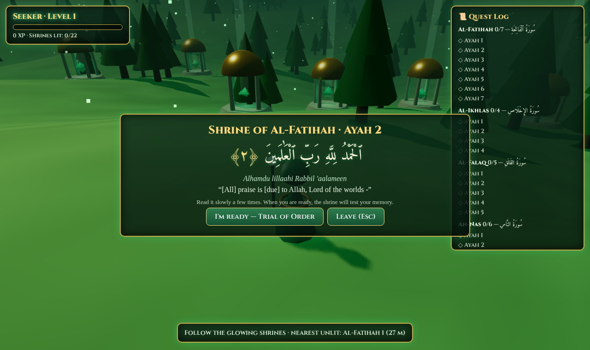

# Quran Quest — The Emerald Vale
A 3D browser game for memorizing short surahs (Al-Fatiha, Al-Ikhlas, Al-Falaq, An-Nas). Walk a green valley (WASD, mouse drag camera, E to interact), visit jade shrines, read each ayah, then rebuild it from shuffled word tiles and fill in the missing word to earn XP.

Arabic text: Uthmani (Tanzil via api.alquran.cloud); English: Sahih International. Built with Three.js.

