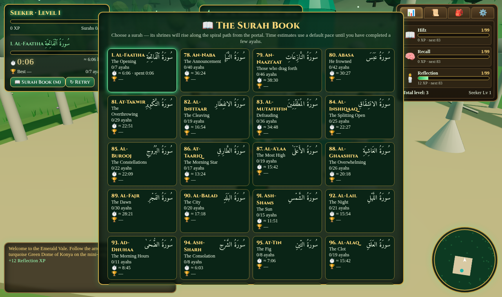

# Quran Quest — The Emerald Vale
A 3D browser game for memorizing Al-Fatiha and all of Juz ʿAmma (surahs 78–114). Walk a green valley, enter the **Portal of Surahs** to choose a surah, and its shrines rise along a spiral path. At each shrine, read the ayah, listen to it (with repeat and loop), read its tafsir, then rebuild it from shuffled tiles and fill in the missing word.

- Per-surah timer, best times, and time estimates based on your pace
- RuneScape-style side interface (Skills, Quests, Inventory, Options), with Hifz, Recall and Reflection skills on the classic 1–99 XP curve; chat log; level-up popups; click-to-move
- Konya courtyard: a Green Dome (Mevlana Museum style), whirling dervishes, and Dede Hasan, who shares lines from Rumi's Mathnawi plus a separate poetry side-quest
- Optional Urdu translation and labels; mini-map and compass; touch controls; progress saved in localStorage

**Play:** https://mrbugimposter3-ship-it.github.io/quran-quest/

## Sources and licenses
- **Quran text:** Tanzil Uthmani text (CC BY 3.0, https://tanzil.net), via api.alquran.cloud `quran-uthmani`. It is used verbatim, except that the Basmala is removed from ayah 1 (other than Al-Fatiha) and a byte-order mark is stripped.
- **Translations and tafsir:** `en.transliteration`, Sahih International (`en.sahih`), al-Tafsir al-Muyassar (`ar.muyassar`) and Fateh Muhammad Jalandhry Urdu (`ur.jalandhry`), all via api.alquran.cloud.
- **Recitation:** Mishary Rashid Alafasy, streamed per ayah from `cdn.islamic.network` (Islamic Network; recordings originally via EveryAyah.com). No audio is redistributed here. Use is non-commercial; this game is free.
- **Rumi:** lines from R. A. Nicholson's translation, *The Mathnawí of Jalálu'ddín Rúmí*, Book I (1926), with verse numbers noted. The text was checked against the Internet Archive scan. This is poetry and is kept clearly separate from the Quran content.
- **Fonts:** Amiri (OFL) and Noto Nastaliq Urdu (OFL, see `fonts/`). Three.js is MIT-licensed.

  
